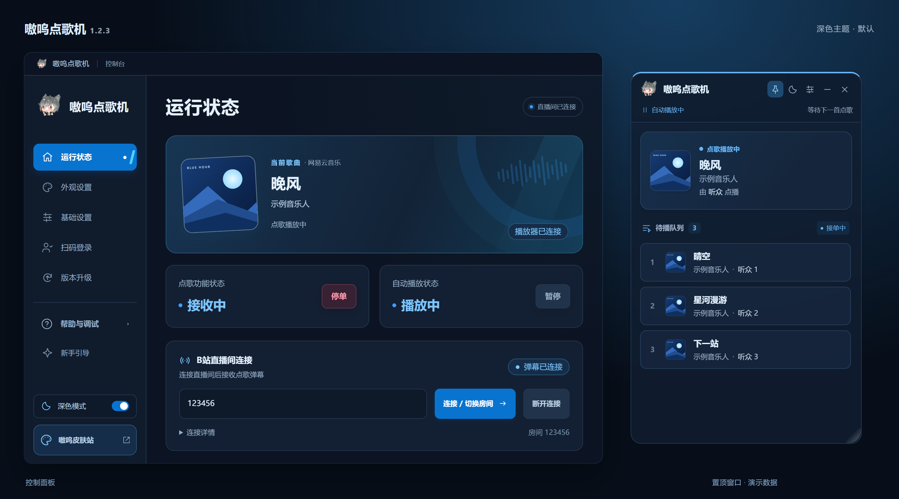
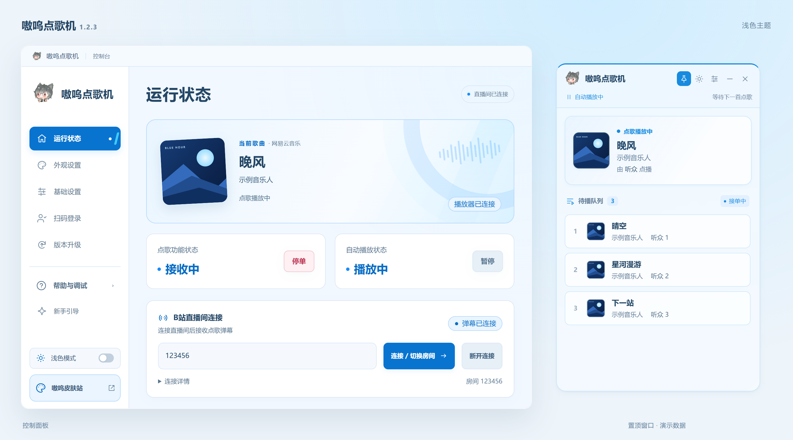

# 嗷呜点歌机

面向 **Bilibili 主播**的 Windows 弹幕点歌工具。观众通过弹幕点歌，
主播在控制面板中管理播放、待播队列和礼物规则，并将歌曲信息展示到直播画面。

支持 **网易云音乐 · 酷狗音乐 · QQ 音乐 · Folia**。

[下载点歌机](https://app.enkianss.us) · [快速开始](#快速开始) · [弹幕指令](#弹幕指令) · [更新记录](https://github.com/Enkianssus/AwooMusicBot/releases)

<p align="center">
  
</p>

<p align="center">1.2.3 界面预览 · 默认深色主题 · 歌曲、队列与直播间状态为演示数据</p>

<details>
  <summary>查看浅色主题</summary>
  <p align="center">
    
  </p>
</details>

## 主要功能

- **弹幕点歌**：支持按歌名、歌曲 ID 或播放器支持的分享链接点歌，自动加入待播队列。
- **队列与权限**：支持撤回、置顶、插队和切歌，可设置分级冷却与用户白名单。
- **礼物点歌**：通过 60 秒礼物学习识别礼物，分别配置普通观众、舰长、提督和总督的点歌次数规则。
- **游客直连**：填写直播间房间号即可使用普通点歌和撤回；管理权限与白名单按需扫码登录。
- **深浅主题**：默认深色，可切换浅色；置顶窗口展示当前歌曲与待播队列，封面和点歌人头像可选。
- **OBS 展示**：在 OBS 或直播姬中添加浏览器源，支持从 GitHub 或本地 ZIP 安装 Mod UI，切换样式无需更换捕捉地址。
- **更新与公告**：启动时提示点歌机和已安装连接器的新版本，查看更新说明并按需更新；更新完成后确认版本。

具体版本改动见 [点歌机更新记录](https://github.com/Enkianssus/AwooMusicBot/releases)
与 [连接器更新记录](https://github.com/Enkianssus/awoo-connectors/releases)。

## 快速开始

1. **打开播放器**，确认可以正常播放歌曲。
2. **打开点歌机**，在“基础设置”中选择播放器，等待对应连接器自动安装并连接。
3. **连接直播间**，在“运行状态”填写 B站直播间房间号。普通点歌无需扫码登录。
4. **试着点一首歌**，在直播间发送 `点歌 歌名`，即可在待播队列中查看。
5. **添加直播展示**，在 OBS 或直播姬中添加浏览器源，复制“外观设置”中的捕捉地址。

> 捕捉地址以软件中显示的实际地址为准，端口冲突时会自动调整。

<details>
<summary>版本通道与播放器兼容说明</summary>

- **嗷呜点歌机**：推荐使用，1.1.x / 1.2.x 共用更新通道；上述功能以最新版本为准。
- **BiliNCM 1.0.x**：面向原有网易云流程的旧通道，只接收同系列修复，不会自动升级到嗷呜点歌机。
- 两个通道均可在 [下载页](https://app.enkianss.us) 获取，并独立检查更新。
- 播放器升级后可能需要更新对应连接器，兼容范围以软件中的版本提示为准。
  QQ 音乐连接器 22.61.2 需要嗷呜点歌机 1.2.1 或更新版本。
  QQ 音乐 22.76 使用连接器 22.76.1，需要本体 1.2.5 的动态能力和新版签名画像支持；
  未适配时会明确提示并停止自动纠正，搜索和手动播放控制仍可使用。

</details>

## 弹幕指令

| 指令 | 功能 | 游客模式 |
|---|---|---|
| `点歌 歌名或ID` | 搜索并加入待播队列 | 可用 |
| `撤回` | 删除自己最近点的一首歌 | 可用 |
| `置顶点歌 歌名` | 放到本地待播队首 | 需登录并满足权限 |
| `插队点歌 歌名` | 中断当前歌曲并插播 | 需登录并满足权限 |
| `立即点歌 歌名` | 立即播放目标歌曲 | 需登录并满足权限 |
| `切歌` / `跳过` | 跳过当前歌曲 | 需登录并满足权限 |
| `开始接单` / `停止接单` | 切换接单状态 | 需登录并满足权限 |

不同播放器使用各自的直接点歌格式：

- 网易云和 Folia：`id=1403356922` 是明确歌曲 ID；6 位以上纯数字是疑似
  ID，会与同文本关键词搜索并行，精确 ID 存在时优先，否则使用关键词结果。
- 酷狗：支持纯数字分享码、`#17154574#`、`chain=ig6N5bG4V3`、裸 chain
  及完整 `m.kugou.com/share/song.html?chain=...` 链接；精确解析失败时回退关键词。
- QQ 音乐：支持完整 `c6.y.qq.com/base/fcgi-bin/u?__=...` 分享链接、
  `u?__=0eBs266kH6Oj` 和裸 12 位分享码；普通纯数字保持关键词搜索。

## 本地只读接口

在“基础设置”中可以分别启用 HTTP API 和 WebSocket 推送，并设置监听端口。
接口只绑定 `127.0.0.1`，默认端口为 `5556`。

- `GET /health`
- `GET /api/v1/state`
- `GET /api/v1/current`
- `GET /api/v1/queue`
- `ws://127.0.0.1:5556/ws`
- OBS 浏览器源示例：`http://127.0.0.1:5556/overlay/`

接口只提供播放与队列状态，不接受控制命令。
完整字段、兼容规则和第三方前端接入方式见
[`docs/external-api.md`](docs/external-api.md)；可直接修改的零构建示例源码位于
[`examples/obs-overlay`](examples/obs-overlay)。

## OBS Mod UI

在“外观设置 → 面向观众 · Mod UI”中可以：

- 输入 GitHub 仓库或发布清单网址，识别并安装 UI。
- 选择本地 ZIP，或将 Mod UI ZIP 拖到安装区域。
- 查看当前使用的 UI，并在已安装的 UI 之间切换。

OBS 始终使用同一个 `/overlay/` 地址，安装或切换 UI 后不需要修改浏览器源。
第三方 UI 的清单、ZIP 结构和安全限制见
[`docs/overlay-mods.md`](docs/overlay-mods.md)。官方示例仓库为
[`Enkianssus/AwooMusicBot-Overlay-Default`](https://github.com/Enkianssus/AwooMusicBot-Overlay-Default)。

## 本地开发

版本号、连接器签名资产、GitHub Actions 上传、Cloudflare 部署和旧版兼容的
完整规范见 [`docs/RELEASING.md`](docs/RELEASING.md)。

```powershell
npm ci
npm test
npm run lint
npx tsc --noEmit
npm run build:dev
```

连接器位于 `BiliNCM-Connectors` 子项目：

```powershell
dotnet build .\BiliNCM-Connectors\BiliNCM.Connectors.slnx -c Release
```

## 技术栈

- Electron、Node.js、React、Vite、TypeScript、Tailwind CSS
- .NET 8 Windows x86/x64 独立播放器连接器与私有共享 Runtime
- Bilibili 原生弹幕 WebSocket
- Velopack、GitHub Actions、Cloudflare 下载代理

## 许可

本项目基于 MIT License。使用时仍需遵守 Bilibili 及各音乐平台的服务条款。
